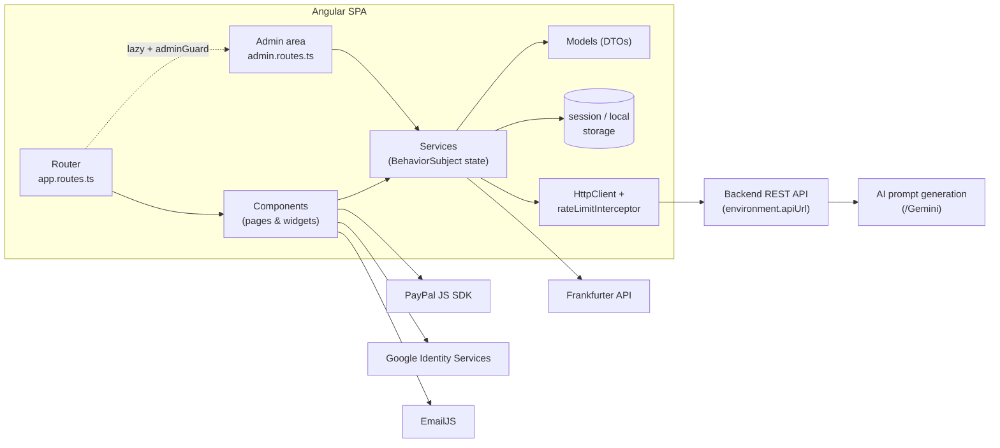

# ClientPromptsShop

> Angular storefront for buying ready-to-use, AI-generated **website-building prompts**.


## Overview

Many people know that AI tools can build websites, but struggle to describe what they want in a way
the AI understands. **ClientPromptsShop** turns that into a shopping experience: users pick a site
type, a target platform and building blocks (pages, features, designs) from a visual catalog, and the
system assembles them into one precise technical prompt they can paste into any AI builder.

This repository contains the **client application** (Angular SPA). It talks to a separate REST backend
(not included in this repository), which stores the catalog, users, carts and orders, and runs AI prompt
generation through its `/Gemini` endpoints.

## Key Features

**Storefront**
- Catalog navigation: main categories → sub-categories → products, with server-side paging.
- Product search, min/max price filters and sorting by price.
- Per-product **target platform** selection (platforms are loaded from the API).
- **Custom AI items**: describe a custom product or category in free text, get an AI-generated
  prompt, edit and regenerate it, then add it to the cart (unused prompts are deleted automatically).
- **Basic site** definition: site name, platform, and either a predefined site type or an
  AI-generated site description.
- Multi-currency prices using live exchange rates from the [Frankfurter API](https://www.frankfurter.app/).

**Cart & checkout**
- Guest cart stored in `sessionStorage` and merged into the user's cart after login.
- Pop-up mini cart and full-screen cart; items can be toggled valid/invalid before checkout.
- **PayPal Checkout** (JS SDK loaded dynamically): the order is created and captured through the backend.

**Orders & reviews**
- Order history with lazily loaded order details.
- Generate the final prompt for an order and download it as a branded **PDF** (jsPDF);
  a copy is also sent by email through EmailJS.
- Star-rating reviews with optional image upload (`multipart/form-data`); public reviews page with paging.

**Accounts**
- Registration and login with reactive-form validation (password match, phone format, password-strength check via the API).
- Google sign-in button (Google Identity Services).
- Profile update page.

**Admin area** (`/admin`, lazy-loaded, protected by a `canMatch` guard)
- Dashboard: total revenue, total / pending / open orders, and the 5 most recent orders.
- Product and sub-category management (create, update, delete; sub-categories support image upload).
- Main-category management, site-type list, and all-orders view with status filter.

**Cross-cutting**
- AI chat assistant widget (`/Chat` endpoint) with conversation kept in `sessionStorage`.
- Accessibility sidebar: high contrast, font scaling, reduced motion and focus indicators
  (saved in `localStorage`), plus a "skip to main content" link.
- Global HTTP interceptor that retries **HTTP 429** responses with exponential backoff + jitter,
  honoring the `Retry-After` header.
- Static pages: platform guides, contact form (EmailJS), privacy / refund / accessibility policies, terms of service, 404.

## Tech Stack

| Area | Technology |
|------|------------|
| Framework | Angular 21 (standalone components, functional guards & interceptors, signals) |
| Language | TypeScript 5.9 (strict mode), SCSS |
| UI | PrimeNG 21 with the Aura theme (`@primeuix/themes`), PrimeIcons |
| State / async | RxJS 7.8 (`BehaviorSubject`-based services), Web Storage |
| Payments | PayPal JavaScript SDK |
| Auth | Email/password via backend API, Google Identity Services |
| Integrations | Frankfurter currency API, EmailJS, jsPDF |
| Build | Angular CLI / `@angular/build` (esbuild + Vite dev server) |
| Testing | Karma + Jasmine |

## Architecture



The app follows a simple layered structure:

- **Components** handle presentation and user interaction only.
- **Services** wrap every HTTP call and expose state as observables (`user$`, `cartItems$`, `orders$`, `error$`, ...).
- **Models** are plain TypeScript classes describing API request/response shapes.
- **Guards / Interceptors / Validators** are small functional units plugged into the router, `HttpClient` and reactive forms.

### Folder structure

```text
src/
├── index.html                  # Loads Google Identity Services
├── main.ts                     # Bootstraps the standalone App component
├── styles.scss                 # Global styles + PrimeNG overrides
├── assets/images/              # Logo, guide and instruction images
├── environments/               # NOT committed – create locally (see below)
└── app/
    ├── app.config.ts           # Providers: router, HttpClient + interceptor, PrimeNG theme
    ├── app.routes.ts           # Public routes + lazy /admin
    ├── Admin/                  # Admin layout, navbar, dashboard and CRUD pages
    ├── Auth/                   # adminGuard (CanMatchFn)
    ├── Components/             # Storefront pages and widgets (cart, chat bot, menu, ...)
    ├── Interceptors/           # rate-limit (HTTP 429) retry interceptor
    ├── Models/                 # DTO classes
    ├── Servises/               # One service per API resource
    └── Validators/             # Custom reactive-form validators
```

## Getting Started

### Prerequisites

- Node.js 20.19+ / 22.12+ (required by Angular 21) and npm
- A running instance of the backend API
- Optional: Google OAuth client ID and PayPal client ID for sign-in and checkout

### 1. Install dependencies

```bash
npm install --legacy-peer-deps
```

`--legacy-peer-deps` is currently needed because `@angular/animations` and `@angular/core` are pinned to
different minor versions.

### 2. Configure environment

The environment files are git-ignored, so create them locally:

- `src/environments/environment.ts` – used by production builds
- `src/environments/environment.development.ts` – used by `ng serve` / development builds

Both files export the same object:

```ts
export const environment = {
  apiUrl: '',             // Base URL of the backend REST API (e.g. https://<host>/api)
  staticFilesUrl: '',     // Base URL for product / category images
  reviewImageBaseUrl: '', // Base URL for uploaded review images
  googleClientId: '',     // Google Identity Services OAuth client ID
  paypalClientId: '',     // PayPal REST app client ID
};
```

| Variable | Used by |
|----------|---------|
| `apiUrl` | All services (`/users`, `/Products`, `/Orders`, ...) |
| `staticFilesUrl` | Product, category, cart and payment images |
| `reviewImageBaseUrl` | Reviews page, home page, order reviews |
| `googleClientId` | Google sign-in on the login page |
| `paypalClientId` | PayPal SDK on the payment page |

### 3. Run the dev server

```bash
npm start            # = ng serve (development configuration)
```

Open **http://localhost:5000** (the port is set in `angular.json`).

### 4. Production build

```bash
npm run build        # output in dist/
```

## Backend API Usage

All endpoints are relative to `environment.apiUrl`. Endpoints containing `/admin` are used by the admin area.

| Resource | Endpoints used by the client |
|----------|------------------------------|
| Users | `POST /users` · `POST /users/loginFunction` · `POST /users/signInWithGoogle` · `GET /users/{id}` · `PUT /users/{id}` · `GET /users/isAdmin/{id}` |
| Password | `POST /password` (strength check) |
| Main categories | `GET /MainCategories` · `POST /MainCategories/admin` · `PUT/DELETE /MainCategories/admin/{id}` |
| Categories | `GET /Categories?numberOfPages&mainCategoryID&pageSize&search` · `GET /Categories/{id}` · `POST /Categories/admin` · `PUT/DELETE /Categories/admin/{id}` |
| Products | `GET /Products?categoryID&numOfPages&PageSize&search&minPrice&MaxPrice&orderByPrice&desc` · `GET/POST /Products/admin` · `PUT/DELETE /Products/admin/{id}` |
| Platforms / site types | `GET /Platforms` · `GET /SiteTypes` |
| Basic site | `POST /BasicSite` · `GET /BasicSite/{id}` · `PUT /BasicSite/{id}` |
| AI prompts | `POST /Gemini/userProduct` · `POST /Gemini/category` · `POST /Gemini/basicSite` · `PUT /Gemini/{id}/{userProduct\|category\|basicSite}` · `GET/DELETE /Gemini/{id}` |
| Cart | `GET /CartsItems?userId` · `POST /CartsItems` · `DELETE /CartsItems/{id}` · `PUT /CartsItems/changeToValid/{id}` · `PUT /CartsItems/changeToNotValid/{id}` |
| Orders | `GET /Orders/userID/{userId}` · `GET /Orders/admin` · `GET /Orders/{id}` · `POST /Orders/{id}/prompt` |
| Payments | `POST /payments/create` · `POST /payments/capture/{paypalOrderId}` |
| Reviews | `GET /Review?currentPage&limit` · `POST /Review` (multipart) |
| Chat | `POST /Chat` |

### Examples

The shapes below come from the client's model classes in `src/app/Models` and services.

**Login** – `POST /users/loginFunction`

```json
{ "userName": "jane@example.com", "userPassward": "********" }
```

Response (`UserModel`):

```json
{ "userID": 12, "userName": "jane@example.com", "firstName": "Jane", "lastName": "Doe", "phone": "0501234567", "basicID": 3 }
```

**Browse products** – `GET /Products?categoryID=4&numOfPages=1&PageSize=8&orderByPrice=true`

Response (`ResponePageModel<ProductModel>`):

```json
{
  "data": [
    { "ProductsID": 21, "CategoryID": 4, "ProductsName": "Contact form", "CategoryName": "Pages", "ImgUrl": "contact.png", "Price": 5 }
  ],
  "totalItems": 17,
  "pageSize": 8,
  "currentPage": 1,
  "hasPreviousPage": false,
  "hasNextPage": true
}
```

**Generate a custom AI prompt** – `POST /Gemini/userProduct`

```json
{ "categoryId": 4, "userRequest": "A booking calendar with email reminders" }
```

Response (`geminiPromptModel`):

```json
{ "promptId": 57, "prompt": "Create a booking calendar component that ..." }
```

**Chat assistant** – `POST /Chat` (response is plain text)

```json
{
  "history": [{ "role": "model", "text": "Hi! I'm your PromptStore assistant 👋 How can I help you today?" }],
  "newMessage": "Which platforms do you support?"
}
```

## Running Tests

The project contains Jasmine unit-test specs (`*.spec.ts`) run by Karma:

```bash
npm test                                          # watch mode, opens Chrome
npx ng test --watch=false --browsers=ChromeHeadless   # single headless run (CI)
```

Karma needs a local Chrome/Chromium installation (set `CHROME_BIN` if it is not on the default path).

## Available Scripts

| Command | Description |
|---------|-------------|
| `npm start` | Start the dev server on port 5000 |
| `npm run build` | Production build to `dist/` |
| `npm run watch` | Development build in watch mode |
| `npm test` | Run unit tests with Karma |
